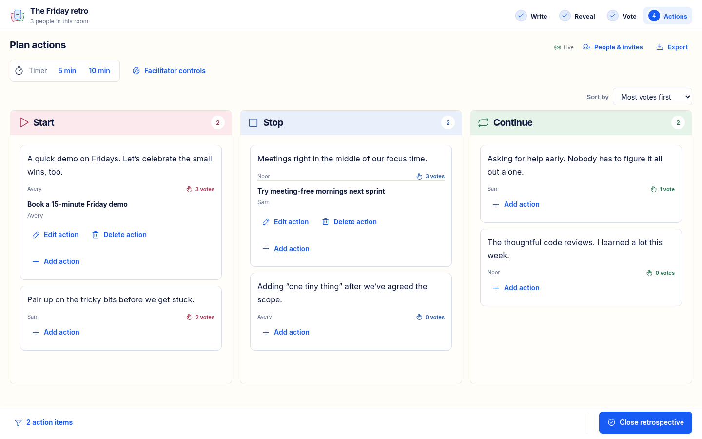
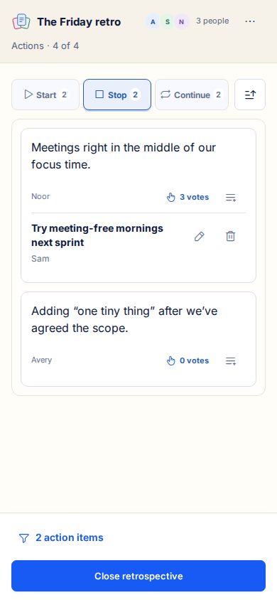

# Retro

A little space for your team to look back, speak up, and decide what to try next.

**[Open Retro →](https://retro.proeftu.in)**



## From thoughts to next steps

1. **Make a room.** Pick a format, set a password, and invite your teammates with their own links. No accounts to create.
2. **Write privately.** Everyone gets time to think before the notes are revealed together.
3. **Find the themes.** Combine related notes, then vote on what matters most.
4. **Leave with a plan.** Turn the conversation into actions with owners, and export the results.

There’s a timer to keep things moving, facilitator handover when you need it, and undo for combined notes. Personal invitations work across devices, so rejoining is easy.

Choose **Mad / Sad / Glad**, **Start / Stop / Continue**, **Went Well / Improve / Try**, or **Keep / Drop / Try**.

## Bring your phone, too

Swipe between categories, vote, and follow the action items from a small screen.



*Screenshots show fictional demo content.*

## Small app, live by design

Retro runs on **[Alchemy Domain](https://alchemy.run/domain/)** and **[Cloudflare Durable Objects](https://developers.cloudflare.com/durable-objects/)**. Each room has its own persistent state, and authorized views keep everyone in sync while protecting private notes and votes. The interface is built with **[Foldkit](https://foldkit.dev/)**.

Unfinished rooms close automatically after a week. Closed rooms are deleted seven days later; export anything you want to keep.

<details>
<summary><strong>Run it yourself</strong></summary>

Install the Bun version in `mise.toml`, then:

```sh
bun install --frozen-lockfile
bun run dev --no-input
```

Open http://localhost:5187. Local development keeps its own state and doesn’t need production credentials. The local admin screen is at `/admin`. Refresh after source changes; HMR is disabled to keep browser sessions independent.

```sh
bun run lint
bun run typecheck
bun run test
bun run build
bun run test:integration # with the dev server running
bunx playwright install chromium
bun run screenshots
```

### Deploy on Cloudflare

Copy `.env.example` to `.env` for local deployment, or configure these GitHub Actions settings:

| Setting | Where |
| --- | --- |
| `CLOUDFLARE_API_TOKEN` | Secret: dedicated deployment token |
| `RETRO_ADMIN_EMAIL` | Secret: identity allowed into the admin screen |
| `CLOUDFLARE_ACCOUNT_ID` | Variable |
| `RETRO_DOMAIN` | Variable: hostname without a scheme or path |
| `RETRO_ACCESS_ISSUER` | Variable: Cloudflare Access team URL |

Production uses Alchemy’s encrypted Cloudflare state store, named `retro`. Bootstrap it once before the first CI deployment:

```sh
bun alchemy state bootstrap --backend cloudflare --name retro --no-input
bun run deploy --stage prod --no-input --yes
```

The token needs Workers Scripts Write, Account Settings Read, Secrets Store Write, and Access: Apps and Policies Write on the account, plus Zone Read, DNS Write, and Workers Routes Write on the site’s zone. See [Alchemy’s CI guide](https://alchemy.run/environments/ci/) for credentials and state setup.

Pushes to `main` run checks and then deploy. Pull requests run checks without deployment credentials. Production deployments run one at a time. For a fork, update the repository guard in the workflow and allow `main` in your `production` environment.

After a successful deployment, a separate job renders the actual app view with fixed fictional data and captures desktop/mobile screenshots. It commits changed images back to `main` using GitHub’s built-in token, without starting another workflow run. No live rooms or Cloudflare credentials are used for screenshots. The fixture and capture script live in `scripts/screenshots/`.

The `CommonGround` infrastructure identifiers preserve the original deployment. Keep them stable when updating an existing installation. Infrastructure state and `.env` files must stay out of Git.

### A quick map of the code

- `packages/domain`: room rules, commands, events, and authorized views.
- `packages/server`: Cloudflare hosting, authentication, and maintenance.
- `packages/web`: the Foldkit interface.
- `scripts`: integration checks against a running local app.

Alchemy is pinned, with three patches in `patches/`: an internal export, Cloudflare runtime reliability/deletion hooks, and Bun’s TypeScript loader. Review these when upgrading Alchemy. The vendored anti-slop lint rules retain their upstream license and attribution in `tools/oxlint`.

</details>

## License

[MIT](LICENSE).
